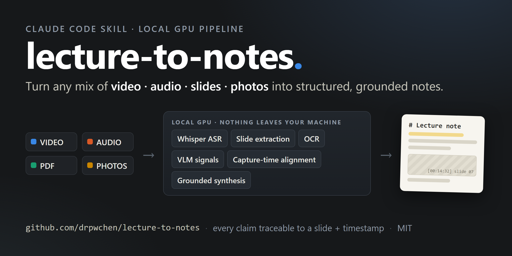
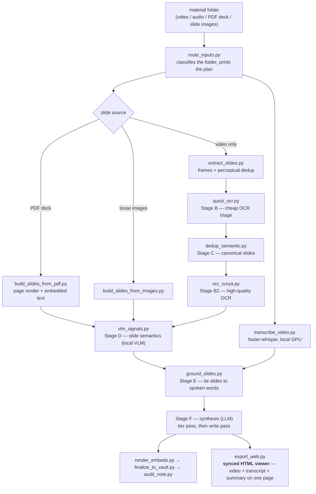
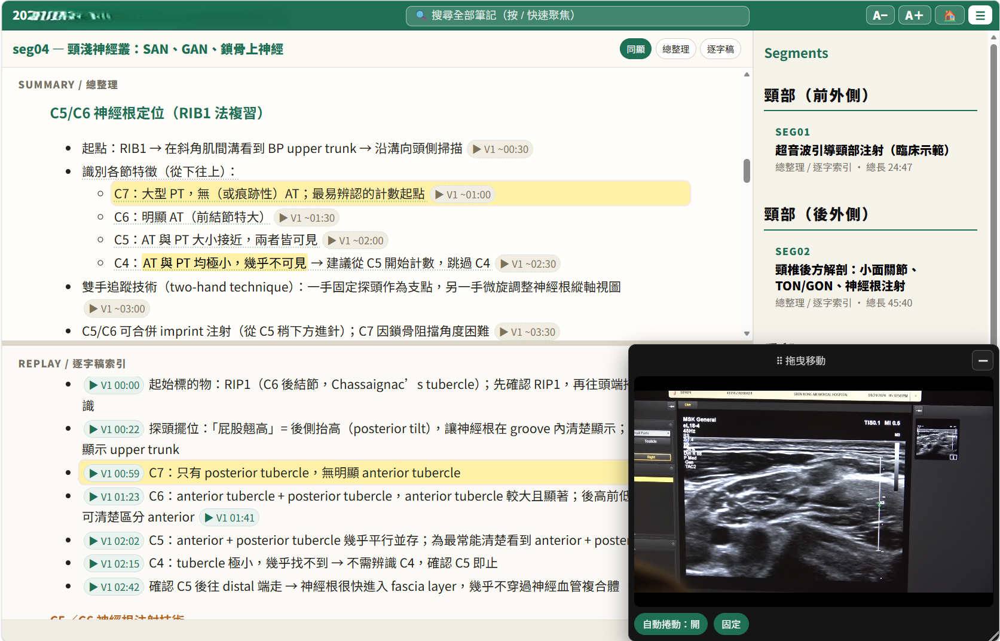
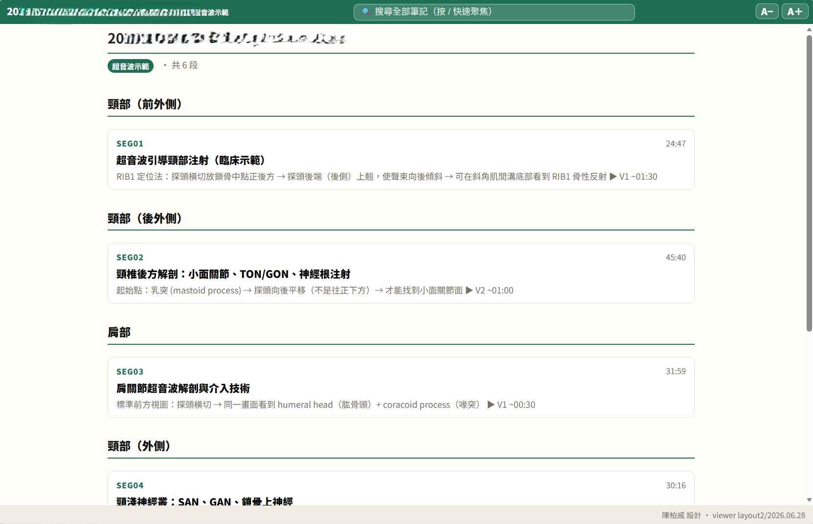
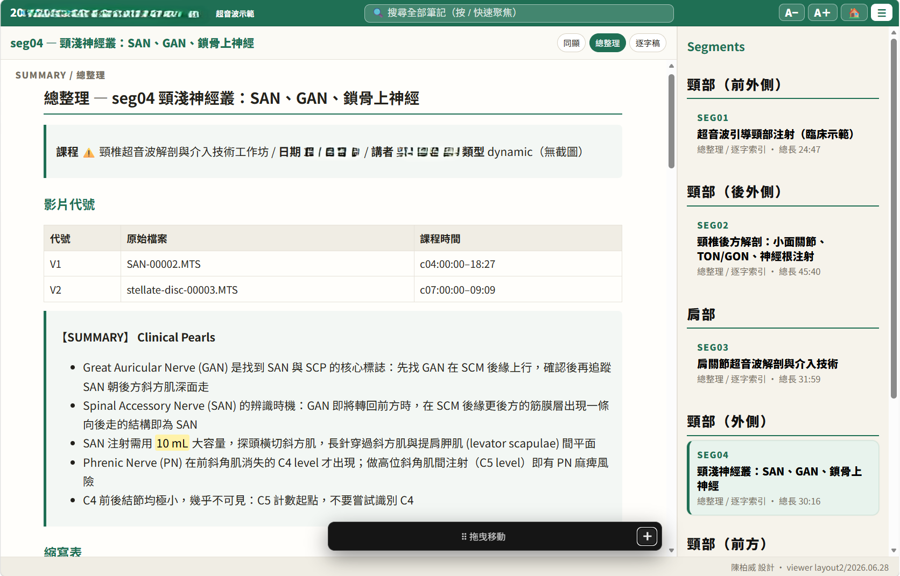

# lecture-to-notes

[](https://github.com/drpwchen/lecture-to-notes/actions/workflows/secret-scan.yml)

**English** · [繁體中文](README.zh-TW.md)



Turn a lecture or conference recording into structured, slide-illustrated notes —
and into a **synced HTML viewer** where the video, the timestamped transcript,
and the curated summary sit on one page: the video highlights the matching note
as it plays, and clicking any note timestamp seeks the video.

Every expensive stage runs **locally**: Whisper ASR on your GPU, frame
extraction, OCR, and a local vision model for slide semantics. An LLM is used
only at the end, to write prose from evidence the pipeline already assembled.

The design goal is not "summarize a video". It is **traceability**: every claim
in the finished note should be attachable to a moment in the transcript and to
the slide that was on screen at that moment. Most of the machinery here exists
to make that link trustworthy rather than plausible.

## Why this exists

Rehabilitation-medicine courses are notoriously hard to take notes on. Manual
therapy, ultrasound scanning — the knowledge is in the *motion*, so at every
course you see a forest of tripods: everyone records everything, planning to
rewatch over dinner. Nobody actually rewatches hours of video.

With AI the first instinct was to teach it precise screenshotting, to squeeze
the video back into a traditional text-plus-figures note. The turn was realizing
a note doesn't have to be that shape at all: build a webpage that ties the video
to the transcript, and you can jump straight to the moment you care about. What
you actually want to know is *how the maneuver is performed* — and that only
lives in motion. So the summary is for studying, the transcript is for
verifying, and the video is one click away from both.

## Requirements

- **Tested on Windows 11** with an NVIDIA RTX 3070 Ti (8 GB). Linux and macOS are untested.
- **Python 3.12** and **`ffmpeg` / `ffprobe` on PATH** (not optional).
- **An NVIDIA GPU (8 GB+) is the fast path, not a requirement.** Without one, transcription falls back to CPU
  automatically and prints an ETA first; a 60-minute lecture then takes hours instead of minutes.
- **Optional:** [ollama](https://ollama.com) with `minicpm-v:8b` (Stage D slide semantics), a separate venv with
  [Surya](https://github.com/VikParuchuri/surya) for OCR, `pandoc` for web/PDF export.
- **Cost:** Stages A-E run locally and cost nothing beyond electricity. The final note-writing step (Stage F)
  uses an LLM through your own agent or API. Hosted ASR (Groq, Gemini) is opt-in, billed to your key, and sends
  audio off your machine.

Small GPUs, hosted-ASR offload, importing an external transcript and Apple Silicon: see
[docs/requirements.md](docs/requirements.md).

## Quickstart

```bash
git clone https://github.com/drpwchen/lecture-to-notes
cd lecture-to-notes

pip install -r requirements.txt
pip install -r requirements-optional.txt     # recommended
cp config.example.yaml config.yaml           # every value is blank/optional by default

ollama pull minicpm-v:8b                     # optional, Stage D

# Put your material in one folder, then ask what to run:
python scripts/route_inputs.py /path/to/material_folder
```

`route_inputs.py` is the front door. It classifies the folder, prints the ordered
commands for the right path, and lists the questions a human has to answer
first. **It is plan-only** — it never runs anything and never writes a file.
For agents and workflow engines, `--json` gives each step as an argv list (no
shell parsing) with `network`, `gpu`, `reads`/`writes` and the `<LANG>`-style
`placeholders` a human must fill before the step is `runnable`.

Then run the printed commands. The first one is transcription, and it will not
start without `--lang`:

```bash
python scripts/transcribe_video.py "lecture.mp4" \
    --output-dir "$OUT_DIR" --lang <zh|en|bilingual|auto>
```

That is deliberate. There is no default language, because guessing wrong makes
Whisper hallucinate fluent Chinese out of accented English and the transcript is
unusable in a way that is not obvious until you read it.

> 🧋 Saved you some time? [Buy me a drink](https://drpwchen.com/en/support/).

**Related tools:** [textbook-to-note](https://github.com/drpwchen/textbook-to-note) (the same idea for textbooks) ·
[ask-your-library](https://github.com/drpwchen/ask-your-library) (search the finished notes) ·
[note-supplement](https://github.com/drpwchen/note-supplement) (merge new material into existing notes)

## Bring whatever you captured

Real courses never produce one tidy recording. Some talks you filmed, some you
only audio-recorded, for some you photographed the slides with your phone, and
sometimes the organizer hands out a PDF deck afterwards. This pipeline takes
the folder **as-is**: `route_inputs.py` figures out what role each file plays,
and the alignment stage stitches every source onto **one shared timeline** —
so the finished note cites the right slide at the right moment even when that
slide never appeared inside the video.

---

## What it does



Stages A–E are plain Python and cost zero LLM tokens. They produce
`slides_grounded.json`: for each canonical slide, its OCR text, its semantic
signals, and the transcript segments spoken while it was on screen. That file is
the input to synthesis, and it is also readable on its own — if you never run
Stage F you still have a transcript, a deduplicated slide set, and the mapping
between them.

## The HTML viewer: video, transcript and summary on one page

The signature output. `export_web.py` builds a **single self-contained HTML
page** per course where the video, the timestamped transcript, and the curated
summary notes are presented **together and kept in sync both ways**
(it also moves each referenced clip into the page's `媒體/影片/` folder — a rename
on the same volume — and rewrites `manifest.json` to match, keeping a `.bak`; pass
`--media-in-place` to leave clips where they are):

- **Video → notes**: as the video plays, the matching note bullet
  auto-highlights and scrolls into view.
- **Notes → video**: every bullet carries a `(Vn MM:SS)` timestamp — click it
  and the video seeks to that moment.
- **Three read modes**: summary only, transcript only, or both side by side —
  the summary layer (curated, workflow-ordered) and the transcript layer
  (verbatim, time-ordered) are separate chapters of the same timeline, so you
  can study top-down and verify bottom-up without leaving the page.
- **Resizable panes, sidebar segment navigation**, slide images inline where
  they were shown.
- **Offline and shareable**: one `.html` plus one support folder (browser-ready
  clips, friendly-named slides, markdown + PDF copies). No server, no build
  step for the reader — send the folder, they double-click the page.
  `--compress` produces a smaller H.264 set for handing around.
- **Notes are data, not markup**: transcript, slide OCR and synthesis text is
  re-serialised through an HTML allowlist (a transcript that says `<script>`
  shows those characters), the embedded timeline JSON cannot end its `<script>`,
  and a Content-Security-Policy pins the page's one inline script by hash and
  allows no network fetches. Tested against a hostile fixture course in a real
  browser (`tests/test_viewer_hostile.py`).

Real output from a cervical-ultrasound workshop (dates and speaker names
blurred):



| Course hub — every segment with duration and a one-line hook | Summary view — per-video source table and key pearls |
|---|---|
|  |  |

The viewer UI lives in `scripts/layout2/` (`viewer.css`, `viewer.js`);
`export_web.py` only generates the per-course timeline manifest and the synced
note HTML, so a UI tweak is an asset edit, not a generator change.

## Markdown notes for your vault

The HTML viewer is the reading surface; **plain markdown is the storage
format**, so everything also lands in your note vault:

- `finalize_to_vault.py` ships the finished note plus its cited slide images
  into an Obsidian-style vault (attachment folder and inbox are configurable
  flags — any folder of markdown works).
- The viewer's support folder contains a `markdown/` copy of every transcript
  and summary, wikilink-rewritten so the folder itself **opens directly as an
  Obsidian vault** — same content as the webpage, readable and searchable in
  your normal note workflow, plus PDF copies for people who want neither.

So you get three durable forms of the same lecture: the synced webpage for
studying, markdown for your knowledge base, PDF for handing to anyone.

## Make your lectures searchable (optional)

Off by default. If you never want search, skip this section — nothing in the
pipeline changes.

A note written for reading is the wrong shape for a retrieval index (one long
file, frontmatter, callouts, embedded slides). `scripts/export_corpus.py` turns
one course's finished notes into a **lecture corpus folder** — one plain
Markdown file per topic, each starting with an H1 and a `Source:` line — by
rules alone: no model, no API key, same notes in → same bytes out.

```bash
python scripts/export_corpus.py "<vault>/00Inbox/20250301_Example_Shoulder US basics.md" \
    --corpus-root ~/lecture-corpus --course-dir 20250301_example_shoulder-US
```

```
~/lecture-corpus/
├── corpus.json        {"format": "t2n-corpus/1", "kind": "lecture"}
└── 20250301_example_shoulder-US/
    ├── _meta.md       speakers, recordings (c01, c02…), note → entry map, abbreviations
    ├── 01_Biceps_groove_landmark.md
    └── 02_….md
```

```markdown
# Biceps groove landmark

Source: 2025-03-01 Dr. Example《Shoulder ultrasound basics》· 20250301_example_shoulder-US · c01

- Start in short axis over the bicipital groove [c01 03:21]
```

- Each `##` section of `# 總整理` becomes an entry (short ones merged, long ones
  split at `###`); slide notes follow, minus every line 總整理 already has.
  `--summary-only` exports 總整理 alone.
- Timecodes become `[cNN MM:SS]`, `cNN` being a recording listed in `_meta.md`.
  A line without a timecode stays without one — nothing is invented.
- Several notes of one course (day 1, day 2, several speakers) go in one call;
  each keeps its own date and speaker in its `Source:` line.
- Re-running for the same course needs `--replace`. `--dry-run` prints the plan.

To make it the last step of every run, set `rag.corpus_root` in `config.yaml`
(or `LECTURE_CORPUS_ROOT`); without either the script prints "RAG export is off"
and writes nothing.

**Indexing is not part of this repo.** The folder follows the
[`t2n-corpus/1` format](https://github.com/drpwchen/ask-your-library/blob/main/docs/corpus-format.md);
[ask-your-library](https://github.com/drpwchen/ask-your-library) (formerly *vault-search*) indexes it in one command:

```bash
python <ask-your-library>/server/corpus.py check ~/lecture-corpus
python <ask-your-library>/server/corpus.py add   ~/lecture-corpus
```

What a rule-based export cannot do: regroup content into new topics, spell
out abbreviations in the text (they are listed in `_meta.md`), convert
Simplified Chinese ASR leftovers, or add a timecode the note never had.
Speaker and title come from the note's frontmatter and title line; for notes
that lack them, pass `--speaker` / `--title` / `--date`.

## Alignment: capture time is a hypothesis, cross-correlation is evidence

The part worth stealing, if you take nothing else.

When a talk is captured by more than one device — a room recording plus phone
clips plus photos — you need a shared timeline. The obvious approach is to trust
each file's capture timestamp. That approach is wrong often enough to matter:
phone clocks drift, some files only have an mtime, and a recording that was
stopped and restarted lies about its own start.

So this pipeline separates the two:

- **`media_capture_index.py`** reads capture times and emits them as *claims*,
  each with a `reliable` flag. A source whose start came from mtime, or has no
  start at all, is marked unreliable and must not be aligned on.
- **`xcorr_media_offsets.py`** measures the actual offset by cross-correlating
  transcripts of the overlapping audio. That is evidence.
- When claim and measurement disagree by more than 5 seconds, the pipeline sets
  `"conflict": true` and **stops**. It never auto-corrects.

The failure this prevents is a 44-minute misalignment that looks completely
normal in the output, because every downstream stage faithfully processes the
wrong pairing. A pipeline that silently reconciles conflicting evidence produces
confident garbage; one that flags the conflict produces a question.

## Is this a Claude Code skill or a set of scripts?

Both, and the distinction matters for what you get.

The repo is laid out as a [Claude Code](https://claude.com/claude-code) skill:
`SKILL.md` is the agent-facing map, and `reference/` holds the detailed specs the
agent reads on demand. Drop the tree into `~/.claude/skills/lecture-to-notes/`
and an agent can drive the whole thing.

**As plain CLI scripts, Stages 0–E work standalone** and give you the transcript,
the canonical slide set, the OCR text, the VLM signals, and the grounding map.
That is most of the value and all of the local compute.

**Stage F — synthesis — is prompt-driven.** It is a specification (in
`reference/note-spec.md`) for what a competent writer should do with
`slides_grounded.json`, not a script that calls an API. There is no
`synthesize.py` you can run. If you are not using an agent driver, treat
`slides_grounded.json` as the handoff point and write your own Stage F against
whatever model you prefer — the spec tells you what the output has to satisfy,
and `audit_note.py` mechanically checks it. [`docs/stage-f-contract.md`](docs/stage-f-contract.md)
is that contract without any provider in it: inputs, the output files and their
keys, and which script checks what afterwards.

## Limitations

- Only tested on Windows 11 with one 8 GB NVIDIA card; Linux, macOS and Apple Silicon are untested.
- Without a GPU, transcription runs but is slow (hours per lecture).
- On an 8 GB card, GPU stages must run one at a time (Whisper and the VLM cannot overlap).
- The transcript is never auto-corrected; suspect tokens are only flagged, so names and numbers still need a human check.
- Hosted ASR (Groq, Gemini) sends audio off your machine and is for non-confidential recordings only; no stage
  falls back from local to cloud by itself.
- Defaults still show their origin (Mandarin Zoom UI dedup list, Traditional Chinese note headings, medical word lists).
  They are config, not code.

## Repo layout

| Path | What is in it |
|---|---|
| `SKILL.md` | The map: hard rules, the numbered pipeline, edge cases |
| `reference/pipeline.md` | Per-stage flags, thresholds, JSON schemas, timeouts |
| `reference/note-spec.md` | Output note spec, slide tier scoring, synthesis prompt requirements |
| `reference/segmented-mode.md` | Multi-talk workshop folders → per-segment notes + hub |
| `reference/multi-camera.md` | One recording + many clips/photos → one timeline |
| `reference/decisions.md` | Post-mortems, benchmarks, wrong turns, VRAM measurements |
| `scripts/` | The pipeline (see `SKILL.md` for what each stage does) |
| `scripts/batch/` | Generic batch layer: segment splitting, language detection, caching |
| `scripts/layout2/` | Web viewer assets for `export_web.py` |
| `tests/` | Dependency-light tests (`pytest`), incl. a hostile-content viewer fixture |
| `pyproject.toml` | Metadata + test config; dependency lists mirror `requirements*.txt` |
| `ocr_bench/` | OCR engine A/B/C harness — bring your own fixtures |
| `data/` | Word/acronym frequency lists used to flag suspect ASR tokens |
| `docs/AUDIT_SUMMARY.md` | What the pre-release audit found, and two things it got wrong |
| `docs/transcript-contract.md` | What `transcript.json` must contain; `import_transcript.py` for an external ASR |
| `docs/stage-f-contract.md` | Stage F (synthesis) inputs, outputs and gates, for any LLM |
| `scripts/export_corpus.py` | Optional: finished notes → a searchable lecture corpus folder (`t2n-corpus/1`) |
| `SECURITY.md` | How to report a vulnerability privately |
| `tools/sync_from_skill.py` | Maintenance: re-export from the upstream skill tree |

## Design notes

The invariants to know before changing anything (transcript never auto-corrected, VLM does no OCR, optional dependencies degrade loudly, provenance on every artifact, no data-derived paths) are in [docs/design-notes.md](docs/design-notes.md).

## Provenance and defaults

This was extracted from a personal note-taking pipeline built for physical
medicine and rehabilitation lectures, and some defaults still show it: the
example config's dedup token list targets Mandarin-language Zoom UI chrome,
the note templates use Traditional Chinese section headings, and the shipped
word lists lean medical. All of it is config, not code — see
`config.example.yaml` and `reference/note-spec.md`.

The two files in `data/` are frequency lists of ordinary dictionary words and
acronyms compiled from a local reference corpus, used only to decide whether an
ASR token looks like a real word. Regenerate them from your own corpus with
`scripts/build_real_words.py` if you want lists tuned to your domain.

## 🌱 Start here if you're new to AI agents

This pipeline is one piece of my personal AI workflow. If you want to learn how
to use AI agents like Claude Code from zero (no programming background needed),
I wrote a beginner series (in Traditional Chinese):

1. [從零開始：安裝、看懂 GitHub、跑起你的第一個工具](https://drpwchen.com/posts/getting-started/)
2. [怎麼跟 AI agent 講話：心法、元技能與規則檔](https://drpwchen.com/posts/talking-to-agents/)
3. [自動化流程不是設計出來的，是長出來的](https://drpwchen.com/posts/growing-your-workflow/)

The story behind this particular tool →
[演講影片變成筆記：本機 GPU 轉錄 + 投影片對位](https://drpwchen.com/posts/lecture-to-notes/)

Full map of my tools and posts → [drpwchen.com/map](https://drpwchen.com/map/)

## License

MIT — see [LICENSE](LICENSE).

## Support 支持

覺得這個工具有幫助嗎？歡迎[請我喝飲料](https://drpwchen.com/support/) 🧋
If this tool helped you, you can [buy me a drink](https://drpwchen.com/en/support/).
