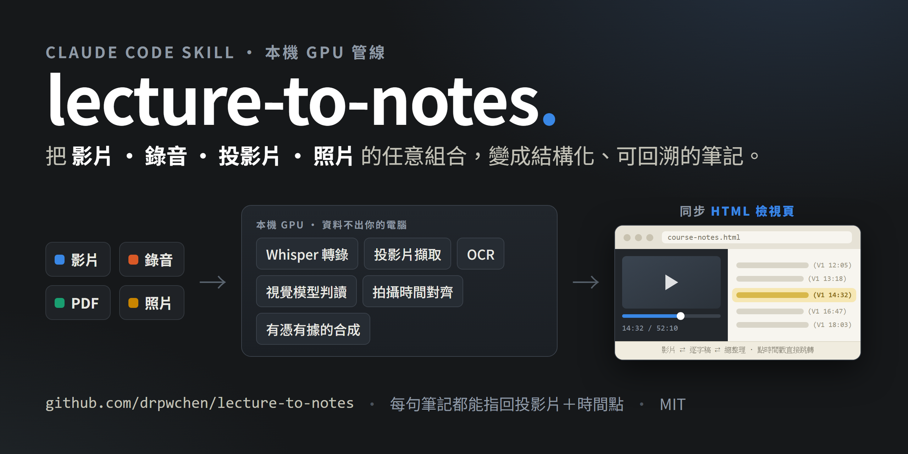
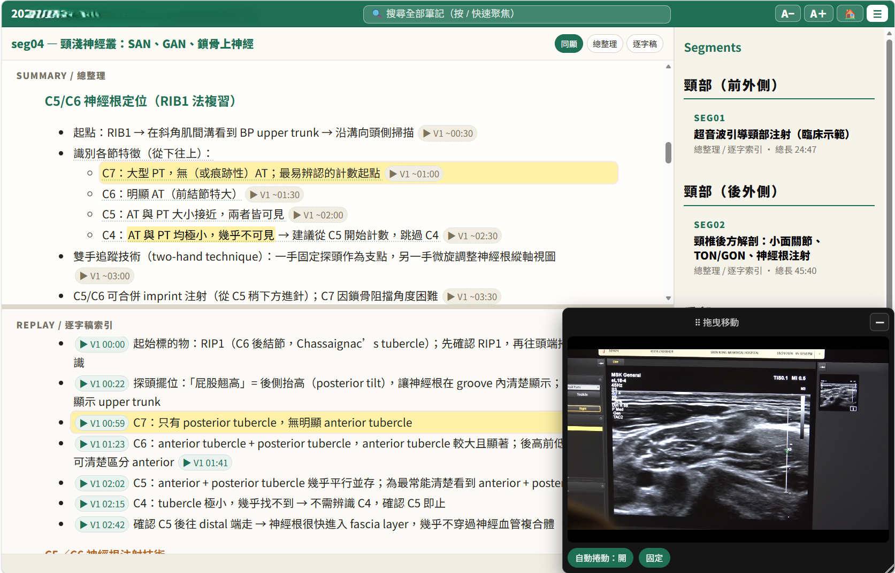
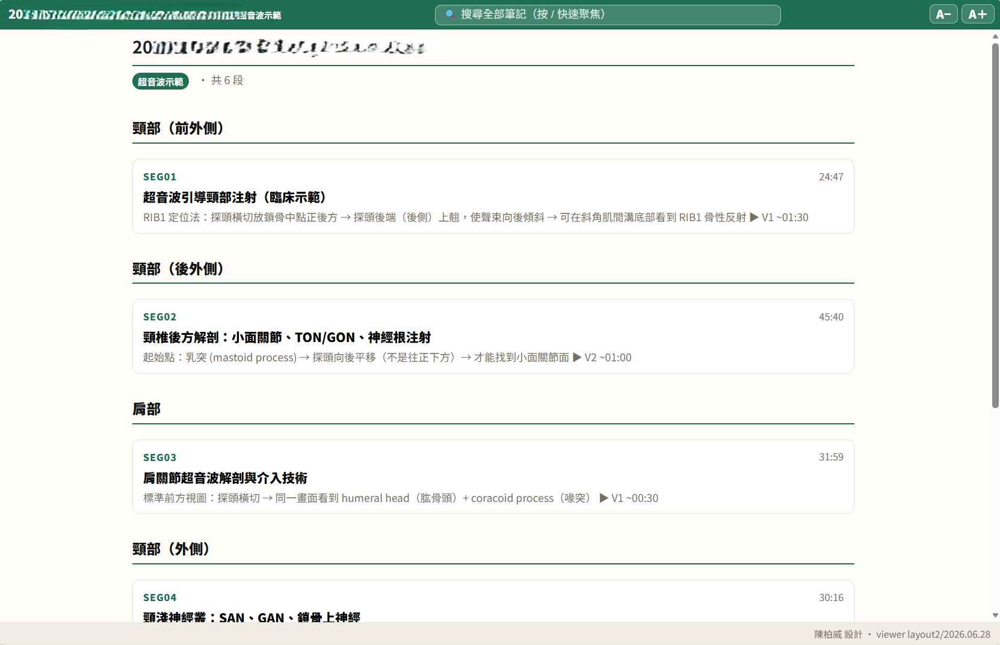
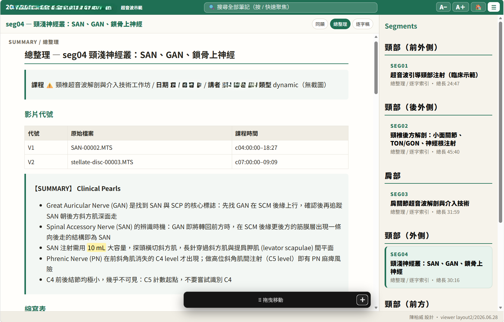

# lecture-to-notes

[](https://github.com/drpwchen/lecture-to-notes/actions/workflows/secret-scan.yml)

[English](README.md) · **繁體中文**



把演講／研討會錄影變成有投影片、可回溯的結構化筆記，並輸出招牌的
**同步 HTML 檢視頁**：影片、逐字稿、總整理在同一頁呈現——影片播到哪，
對應筆記自動高亮捲動；點筆記上的 `(Vn MM:SS)` 時間戳，影片直接跳到那一刻。

重的階段全部在本機跑：Whisper 轉錄、抽幀、OCR、本地視覺模型判讀投影片語意。
LLM 只在最後一步負責寫，而且只能根據前面產生的證據寫。

設計目標不是「摘要一支影片」，而是**可回溯**：筆記裡每一句話都應該能指回逐字稿
的某個時間點，以及當下螢幕上的那張投影片。這裡大部分的機制都是為了讓這條連結
「可信」而不只是「看起來合理」。

## 起心動念

從以前就覺得復健科的課程很難做筆記——特別是徒手治療、超音波影像這種，知識
藏在「動作」裡，要有影片才學得起來。所以很多復健科的課，現場都是滿滿的腳架，
大家錄回去打算配飯複習。但實際上，幾小時的影片根本不會回去看完。

有了 AI 之後，原本的思路是教它精準截圖，把影片塞回傳統「文字＋圖片」的筆記
形式。後來想通了：筆記不必拘泥於那個形狀。直接做成一個網頁，把影片跟逐字稿
對上，想看哪段就跳到哪段——畢竟真正想知道的，是動態下到底怎麼操作！於是變成
現在的形式：總整理拿來讀、逐字稿拿來驗證、影片永遠在一鍵之外。

## 環境需求

- Windows 11 實測（NVIDIA RTX 3070 Ti 8GB）。Linux/macOS 理論上可行但未測。
- Python 3.12、`ffmpeg` 與 `ffprobe` 必須在 PATH。
- **NVIDIA GPU（8GB 以上）是快速路徑，不是硬需求。**沒有的話：
  - **CPU fallback 內建**——轉錄自動降到 CPU int8，開跑前先誠實印出預估時間
    （一小時的課會從幾分鐘變成幾小時）。OCR 快篩階段本來就對 CPU 友善。
  - **2–4 GB 的小顯卡等同沒有顯卡。**`large-v3` 級的模型要 ~4.5 GB；GPU 預檢會
    回報 `GPU_TOO_SMALL` 然後放行走 CPU 路徑。要跑得動請換小模型——
    `transcribe_video.py ... --device cpu --model small`（或 `medium`）——或改用
    下面的 `--engine groq`。這種機器請跳過 Stage D（`minicpm-v:8b`）與 Surya OCR；
    RapidOCR 本來就只用 CPU。
  - **轉錄外包給雲端 Whisper**——`scripts/groq_asr.py` 把壓縮後的音訊送
    Groq 的 `whisper-large-v3-turbo`（免費層可用；25 MB 上限自動分段），
    回傳格式與本機路徑完全相容。先讀它的 docstring：雲端版對中英混講的
    防崩潰參數全都沒有，而且音訊會離開你的電腦——機密錄音別走這條。
  - **轉錄外包給 Gemini**——`scripts/asr_gemini_primary.py` 以 Gemini 為主文字，
    本機 breeze25 只負責時間軸、兼當核對人名數字的第二來源（Gemini 是 LLM，會換人名、
    偶爾和投影片矛盾）。15 段課程片段 Gemini 命中 97–100 % 參考術語，最好的本機模型
    64–85 %（依類別）；遠場會場錄音 82 % 對 54–60 %。兩條路線由 `gemini_asr.py --via` 決定：
    - `api`（預設）——用 `GEMINI_API_KEY` 打 REST API，費用記在那把 key。
    - `agy`——Antigravity CLI 的 headless 模式（僅限 Windows＋WSL Ubuntu），用登入那個 Google 帳號的額度。
      **先讀 `gemini_asr.py` 裡的服務條款說明。**依 Google AI Developers Forum
      （2026-10-16）轉述的官方 FAQ：consumer 方案（含 Pro）在第三方 coding agent 裡
      跑 headless `agy` 不受支援，即使是以本機子程序呼叫官方 binary 也一樣，可能被停權；
      直接寫的 script 與 CI 則被描述為可以。AI agent 啟動的 script 算不算「直接」
      沒有定論。請自行確認最新 FAQ；有疑慮就用 `api`。
    兩條路線音訊都會離開你的電腦——機密錄音別走。設 `LECTURE_LOCAL_ONLY=1`（或
    `config.yaml` 的 `privacy.local_only: true`），Groq 與 Gemini 路線會在上傳前就結束；
    任何階段都不會自行從本機退回雲端。
  - **逐字稿從別處來**——MLX Whisper、雲端 STT、創作者字幕、人工逐字稿：
    `scripts/import_transcript.py` 把 SRT、WebVTT 或 whisper 格式的 JSON 轉成管線的
    `transcript.json`（[規格](docs/transcript-contract.md)），Stage 0 直接跳過。
  - **Apple Silicon** 理論上以 CPU 模式可行（faster-whisper 走 CPU、
    ollama 原生支援 macOS），或用上面的方式匯入 MLX Whisper 的輸出——合理但未實測；
    GPU 預檢目前沒有 Apple Silicon 的資源設定。歡迎回報。
- 選配：ollama + `minicpm-v:8b`（Stage D）、獨立 venv 的 Surya（高品質 OCR）、
  pandoc（網頁／PDF 匯出）。
- 8GB 顯卡上 GPU 階段必須序列化：Whisper 和 VLM 不能同時跑，抽幀也不能和轉錄
  搶卡。轉錄直接用預設值（只給 `--lang`）：n=15 實測 `--beam-size 10` 召回率反而下降、
  時間 1.7 倍；加大 beam／batch 只用在防崩潰重跑。
- **費用：**Stage A–E 在本機跑，只花電費。最後寫筆記的 Stage F 會透過你自己的 agent 或 API 用到 LLM。雲端轉錄（Groq、Gemini）是選用，費用記在你的 key，音訊會離開你的電腦。

## 快速開始

```bash
git clone https://github.com/drpwchen/lecture-to-notes
cd lecture-to-notes

pip install -r requirements.txt
pip install -r requirements-optional.txt
cp config.example.yaml config.yaml

python scripts/route_inputs.py /path/to/素材資料夾
```

給 agent／workflow 引擎用的話加 `--json`：每一步都附 argv 陣列（不經 shell 解析），
以及 `network`、`gpu`、`reads`／`writes`，和需要人先填的 `<LANG>` 這類
`placeholders`——填完才算 `runnable`。

照印出來的指令跑。轉錄一定要給 `--lang`，沒有預設值——語言猜錯的話 Whisper
會把有口音的英文幻覺成流暢的中文，而且要等你讀了逐字稿才會發現。

> 🧋 省了你時間的話，[請我喝杯飲料](https://drpwchen.com/support/)。

**相關工具：** [textbook-to-note](https://github.com/drpwchen/textbook-to-note)（同一套思路，對象是教科書）· [ask-your-library](https://github.com/drpwchen/ask-your-library)（搜尋做好的筆記）· [note-supplement](https://github.com/drpwchen/note-supplement)（把新素材補進既有筆記）

## 手上有什麼就帶什麼來

真實的課程從來不會只有一支乾淨的錄影：有的講題你錄了影、有的只錄到音、
有的只用手機拍了投影片，會後主辦單位又補發一份 PDF 講義。這條管線把資料夾
**原樣**吃進去：`route_inputs.py` 判斷每個檔案扮演什麼角色，對齊階段再把所有
來源接上**同一條時間軸**——就算某張投影片從頭到尾沒出現在影片畫面裡，
筆記引用到它的那一刻仍然指得回正確的時間點。

## 同步 HTML 檢視頁：影片、逐字稿、總整理同一頁

招牌輸出。`export_web.py` 為每門課產生**單一自包含 HTML 頁**，三樣東西雙向同步：

- **影片 → 筆記**：影片播放時，對應的筆記條目自動高亮並捲動到可見位置。
- **筆記 → 影片**：每條筆記都帶 `(Vn MM:SS)` 時間戳，點下去影片直接跳轉。
- **三種閱讀模式**：只看總整理、只看逐字稿、或並排對照——總整理層（策展過、
  按臨床流程排）和逐字稿層（逐字、按時間排）是同一條時間軸的兩章，
  由上而下讀、由下而上驗證，不用離開頁面。
- **可拉動的分割面板、側欄段落導覽**，投影片圖就嵌在它出現的位置。
- **離線可分享**：一個 `.html` 加一個素材資料夾（瀏覽器可播的影片、
  友善命名的投影片、markdown 與 PDF 副本）。不用架伺服器，把資料夾傳給
  對方，點兩下就能看。`--compress` 可產生較小的 H.264 分享包。
- **筆記內容一律當資料，不當網頁碼**：逐字稿、投影片 OCR、整理稿的文字都先過
  HTML 白名單（逐字稿裡講到 `<script>`，頁面上就顯示這幾個字）；內嵌的時間軸 JSON
  無法提前結束 `<script>`；Content-Security-Policy 只放行這頁唯一一段內嵌腳本
  （以雜湊值鎖定），而且不准任何網路連線。以一份惡意內容的測試課程在真實瀏覽器裡
  驗證（`tests/test_viewer_hostile.py`）。

實際輸出（一場頸椎超音波工作坊；日期與講者已馬賽克）：



| 課程首頁——每段的長度與一句話重點 | 總整理頁——影片代號表與臨床 pearls |
|---|---|
|  |  |

檢視頁的 UI 在 `scripts/layout2/`（`viewer.css`、`viewer.js`）；
`export_web.py` 只負責產生時間軸 manifest 和同步筆記 HTML——改 UI 是改資產檔，
不是改產生器。

## Markdown 輸出：放進你的筆記庫

HTML 檢視頁是閱讀介面；**markdown 才是儲存格式**，所有內容也會以純文字落地：

- `finalize_to_vault.py` 把完成的筆記連同引用的投影片圖，直接歸檔進
  Obsidian 式筆記庫（附件資料夾與收件匣位置都是可設定的 flag，
  任何放 markdown 的資料夾都行）。
- 檢視頁的素材資料夾裡有 `markdown/`，收錄每段逐字稿與總整理的副本，
  wikilink 都改寫好了——**整個資料夾直接當 Obsidian vault 打開**，
  跟網頁同一份內容，在你平常的筆記流程裡可讀可搜。另附 PDF 副本。

所以同一堂課會有三種耐放的形態：同步網頁拿來研讀、markdown 進知識庫、
PDF 給誰都能開。

## 讓演講可以被搜尋（選用）

預設關閉。不需要搜尋就跳過這一節，管線其他部分完全不受影響。

給人讀的筆記不適合直接拿去建檢索索引（一個長檔、frontmatter、callout、嵌入的投影片）。
`scripts/export_corpus.py` 把一門課完成的筆記轉成**演講語料資料夾**：一個主題一個純 Markdown 檔，
開頭是 H1 加一行 `Source:`。全部照規則轉，不呼叫模型、不需要 API key，同樣的筆記進去，
出來的位元組也一樣。

```bash
python scripts/export_corpus.py "<vault>/00Inbox/20250301_範例醫師_肩關節超音波入門.md" \
    --corpus-root ~/lecture-corpus --course-dir 20250301_範例醫師_肩關節超音波入門
```

```
~/lecture-corpus/
├── corpus.json        {"format": "t2n-corpus/1", "kind": "lecture"}
└── 20250301_範例醫師_肩關節超音波入門/
    ├── _meta.md       講者、錄影代號（c01、c02…）、筆記 → 條目對照、縮寫表
    ├── 01_二頭肌溝定位.md
    └── 02_….md
```

```markdown
# 二頭肌溝定位

Source: 2025-03-01 範例醫師《肩關節超音波入門》· 20250301_範例醫師_肩關節超音波入門 · c01

- 探頭短軸放在二頭肌溝上開始掃 [c01 03:21]
```

- `# 總整理` 底下每個 `##` 一個條目（太短的合併、太長的在 `###` 切開）；逐投影片筆記接在後面，
  總整理已經有的句子不重複。只要總整理就加 `--summary-only`。
- 時間碼轉成 `[cNN MM:SS]`，`cNN` 是 `_meta.md` 列出的錄影代號。筆記裡沒標時間的句子就不標，
  不會自己編。
- 同一門課的多份筆記（第一天、第二天、不同講者）一次給；每份的 `Source:` 保留自己的日期與講者。
- 同一門課重跑要加 `--replace`；`--dry-run` 只印計畫。

想讓每次跑完都自動輸出，就在 `config.yaml` 設 `rag.corpus_root`（或環境變數
`LECTURE_CORPUS_ROOT`）；兩個都沒設時，腳本印出「RAG export is off」、什麼都不寫。

**建索引不在這個 repo。** 資料夾格式是
[`t2n-corpus/1`](https://github.com/drpwchen/ask-your-library/blob/main/docs/corpus-format.md)，
[ask-your-library](https://github.com/drpwchen/ask-your-library)（舊名 vault-search）一行指令就能建索引：

```bash
python <ask-your-library>/server/corpus.py check ~/lecture-corpus
python <ask-your-library>/server/corpus.py add   ~/lecture-corpus
```

規則式轉換做不到的事：把內容重新歸成新的主題、在正文裡展開縮寫（縮寫表放在 `_meta.md`）、
把 ASR 殘留的簡體字轉繁體、補上筆記原本沒有的時間碼。講者與課名取自筆記的 frontmatter
與標題行；筆記沒有這些資訊時，用 `--speaker`／`--title`／`--date` 指定。

## 管線做了什麼

Stage A–E 是純 Python、零 LLM token：轉錄（faster-whisper）、抽幀＋感知去重、
OCR 兩階段（RapidOCR 快篩 → Surya 精讀）、本地 VLM 判讀投影片語意、
最後把投影片跟「講到它的那段話」綁定，產出 `slides_grounded.json`。
就算不跑最後的合成，你也已經拿到逐字稿、去重後的投影片集、和兩者的對應表。

素材入口是 `python scripts/route_inputs.py <素材資料夾>`——它判斷你手上有
什麼（影片／錄音／PDF／照片的任意組合）、印出該走哪條路線的完整指令、
列出需要人先回答的問題。它只規劃、不執行、不寫檔。

## 多來源對齊：拍攝時間是假設，交叉相關是證據

一場演講如果同時有主錄影、手機側錄和照片，需要一條共同時間軸。直覺做法是相信
每個檔案的拍攝時間戳——但手機時鐘會漂、有些檔案只剩 mtime、中途停過再開的錄影
會謊報自己的起點。

所以這裡把兩件事分開：`media_capture_index.py` 只產生「宣稱」（附 `reliable`
旗標，不可靠的來源不准拿來對齊），`xcorr_media_offsets.py` 用重疊音訊的逐字稿
交叉相關「量測」實際偏移。兩者差超過 5 秒就標 `"conflict": true` 交給人判斷，
絕不自動修正。這擋掉的是那種 44 分鐘錯位、但輸出看起來完全正常的災難。

## 限制

- 只在 Windows 11＋一張 8 GB NVIDIA 顯卡上測過；Linux、macOS、Apple Silicon 都沒測。
- 沒有 GPU 也能跑，但很慢（一堂課要數小時）。
- 8 GB 顯卡上 GPU 階段要一個一個跑（Whisper 與 VLM 不能同時）。
- 逐字稿不會被自動修正，只標記可疑字詞；人名與數字仍要人工核對。
- 雲端轉錄（Groq、Gemini）會把音訊送出電腦，只適合非機密錄音；任何階段都不會自行從本機退回雲端。
- 預設值仍看得出出身（中文 Zoom UI 字典、繁中筆記標題、偏醫學字表），這些是 config 不是 code。

## 要先知道的設計

- **逐字稿永不自動修正**。可疑詞只會被「標記」到 `asr_suspects.txt`，逐字稿本身
  一個 byte 都不動。兩版自動修正都做過、量測過、然後撤掉了
  （`reference/decisions.md`）。
- **VLM 不做 OCR**。Stage D 只問視覺模型語意訊號，文字一律來自 OCR 階段。
- **選配套件缺了要吵**。缺套件就關掉該功能並講清楚少了什麼，絕不偷偷換一個比較
  差的方法——「輸出變錯」比「輸出變少」貴太多，細節見 `docs/AUDIT_SUMMARY.md`。
- **每個產物都記得自己怎麼來的**。各階段把工具、引擎、模型、參數、有沒有連網、
  輸入的雜湊寫進產物旁的 `provenance.json`；`python scripts/provenance.py verify <dir>`
  會指出寫出後被改過、或輸入在那之後變了的檔案。
- **資料檔裡的名字不會變成路徑**。slug、`attachment_name`、嵌圖目標都來自 JSON 或
  LLM 寫的筆記，一律檢查是否留在你在指令列給的資料夾內（會追 symlink），越界就拒絕，
  不會偷偷改成別的名字。

## 這是 skill 還是一堆腳本？

兩者都是。目錄結構是 Claude Code skill（`SKILL.md` 是給 agent 讀的地圖，
`reference/` 是細節），丟進 `~/.claude/skills/` 就能讓 agent 全程驅動。

當成純 CLI 用的話，Stage 0–E 都能單獨跑，會給你逐字稿、去重後的投影片、OCR
文字、VLM 訊號，以及兩者的對應表——這是大部分的價值。但 **Stage F 合成是
prompt 驅動的規格（`reference/note-spec.md`），不是可執行腳本**，沒有
`synthesize.py`。不用 agent 的話，請把 `slides_grounded.json` 當交接點，自己接
想用的模型；規格說明產物要滿足什麼條件，`audit_note.py` 會機械化檢查。
不綁任何供應商的版本在 [`docs/stage-f-contract.md`](docs/stage-f-contract.md)：
輸入、輸出檔與欄位、之後由哪支腳本檢查什麼。

## 出身

這是從一套個人筆記管線（復健科演講）抽出來的，預設值還看得出來歷：dedup 的
UI 雜訊字典針對中文 Zoom、筆記模板用繁中標題、字表偏醫學。這些全都是 config
不是 code，見 `config.example.yaml` 與 `reference/note-spec.md`。

## 🌱 AI agent 新手起點

這套管線是我個人 AI 工作流的一部分。想從零開始學怎麼用 Claude Code 這類 AI
agent（不需要程式背景），可以從我的入門系列開始：

1. [從零開始：安裝、看懂 GitHub、跑起你的第一個工具](https://drpwchen.com/posts/getting-started/)
2. [怎麼跟 AI agent 講話：心法、元技能與規則檔](https://drpwchen.com/posts/talking-to-agents/)
3. [自動化流程不是設計出來的，是長出來的](https://drpwchen.com/posts/growing-your-workflow/)

這個工具本身的來龍去脈 →
[演講影片變成筆記：本機 GPU 轉錄 + 投影片對位](https://drpwchen.com/posts/lecture-to-notes/)

所有工具與文章的全貌 → [drpwchen.com/map](https://drpwchen.com/map/)

授權 MIT — 見 [LICENSE](LICENSE)。

## Support 支持

覺得這個工具有幫助嗎？歡迎[請我喝飲料](https://drpwchen.com/support/) 🧋
If this tool helped you, you can [buy me a drink](https://drpwchen.com/en/support/).
